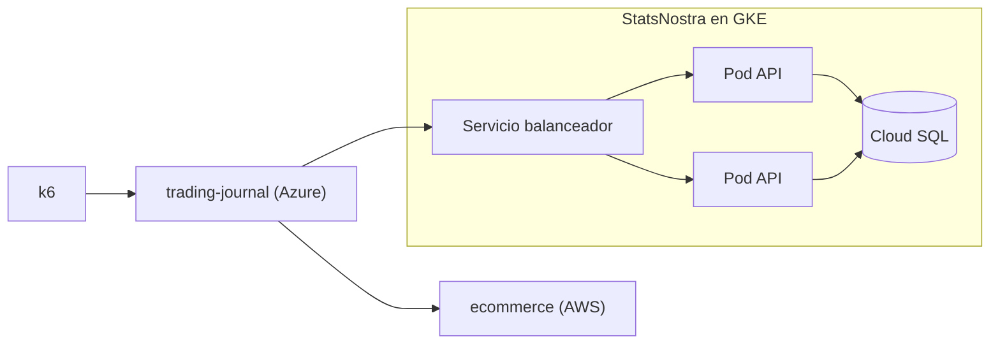

# StatsNostra

API REST de predicciones deportivas. Los apostadores predicen el marcador de partidos y suman
puntos según qué tan cerca estuvieron cuando el partido termina.

Esta rama (`v5`) parte de la versión 2 de la API y corre en Google Cloud sobre Kubernetes (GKE).
Sirve de base para los experimentos de caos del grupo: ingeniería del caos (DevOps) y caos de
seguridad (defensa en profundidad).

**v5**
<p>
  
  
  
  
  
  
  
</p>

## Las tres APIs del grupo

| API | Nube | Qué hace en el flujo |
|---|---|---|
| StatsNostra (esta) | Google Cloud, GKE | Partidos y predicciones |
| trading-journal | Azure (cómputo) y Oracle (datos) | Arma el flujo completo y llama a las otras dos |
| ecommerce | AWS, EKS | Comercios y productos |

Una petición `GET /api/v2/trades/{id}` a trading-journal consulta a StatsNostra y a ecommerce, y
el mismo `X-Trace-Id` queda en los logs de las tres nubes.

## Dónde corre

- API: http://34.68.14.217 (Swagger en `/docs`). La infraestructura de esta entrega se destruye al
  terminar, así que la IP solo responde mientras dura.
- Código: https://github.com/MarianaPineda0/StatsNostra, rama `v5`.



La infraestructura se crea con Terraform (ver [`terraform/`](terraform/README.md)): red, clúster
GKE zonal con Dataplane V2 (que aplica las NetworkPolicy), Cloud SQL sin redes autorizadas, IP pública
reservada, repositorio de imágenes y cuentas de servicio con permisos mínimos. Los pods llegan
a la base solo por el Cloud SQL Auth Proxy, como contenedor acompañante.

## Endpoints

CRUD completo de las tres entidades, con las rutas originales y bajo `/api/v1`:

```
/apostadores   /partidos   /predicciones      (POST, GET, GET {id}, PUT, PATCH, DELETE)
POST /partidos/{id}/finalizar                 evalúa todas las predicciones del partido
QUERY /query/...                              lecturas compuestas (ranking, estadísticas, filtros)
```

La versión 2 (`/api/v2/apostadores|partidos|predicciones`) agrega al `GET /{id}` un registro de
trading-journal y otro de ecommerce, y se identifica con `X-App-Name`. Si alguna de las dos APIs
no responde, ese campo sale en `null` y la API sigue funcionando.

Rutas que usan los experimentos y Kubernetes:

| Ruta | Para qué |
|---|---|
| `/health/live` | Liveness: el proceso está vivo |
| `/health/ready` | Readiness: atiende. Si `READINESS_LAG_MS` es mayor que 0, responde 503 cuando el bucle de eventos se atrasa más de ese valor (pod saturado) |
| `/metrics` | Métricas de Prometheus, incluido el retraso del bucle de eventos |
| `/fault/cpu` | Consumo de CPU para el experimento; solo existe con `FAULT_HEADER_ENABLED=true` |

Con `FAULT_HEADER_ENABLED=true`, la cabecera `X-Inject-Fault: error|latency|cpu` activa la falla
correspondiente en las rutas de negocio (nunca en las de salud ni en `/metrics`). Apagado es el
valor por defecto.

Cada petición deja una línea de log en JSON con hora UTC, API, trace id, método, ruta, status y
duración en milisegundos.

## Reglas de negocio y puntos

Un apostador activo puede hacer una sola predicción por partido y solo mientras el partido no
haya finalizado. Un partido no se puede finalizar dos veces. Al finalizarlo:

| Resultado | Puntos |
|---|---|
| Marcador exacto | 3 |
| Acierta el ganador o el empate, falla el marcador | 1 |
| Falla el ganador | 0 |

## Experimentos de caos

Todo vive en [`caos/`](caos/README.md): el estado estable medido, el experimento como código, la
carga con k6, la evidencia de cada ronda, el tablero y el informe.

El experimento de DevOps satura la CPU de un pod durante 3 minutos con un perfil de carga fijo:

| | p95 del flujo | Éxito |
|---|---|---|
| Estado estable | 1.208 ms | 100 % |
| Ronda 0, sin mejoras | 3.425 ms (no cumple el límite de 1.511 ms) | 100 % |
| Ronda 1, con readiness por saturación, más CPU y HPA | 774 ms | 100 % |

Informe: [`caos/informe/informe-caos-statsnostra.pdf`](caos/informe/informe-caos-statsnostra.pdf).

## Desplegar

```bash
# 1. Infraestructura (una vez). Necesita Terraform 1.11 o superior.
cd terraform
terraform init -backend-config="bucket=NOMBRE-DEL-BUCKET-DE-ESTADO"
terraform plan
terraform apply

# 2. La API: construye la imagen, migra la base y actualiza el clúster
gcloud container clusters get-credentials statsnostra-v5-gke --zone us-central1-a
bash scripts/desplegar-gke.sh
```

El workflow `desplegar-gke.yml` hace lo mismo con cada merge a `v5` que cambie `app/`, `k8s/`,
las migraciones o el script, y termina con una prueba de humo. Se autentica con Workload
Identity Federation, sin llaves en el repositorio.

Los manifiestos están en [`k8s/`](k8s/): Deployment con requests y límites, sondas de liveness y
readiness, Service, HPA (2 a 4 réplicas, 60 % de CPU), ConfigMap y el Job de migración.

## Ejecutar en local

```bash
cp .env.example .env
docker compose up -d db
pip install -r requirements-dev.txt
alembic upgrade head
uvicorn app.main:app --reload
```

Las pruebas usan un PostgreSQL real, no mocks:

```bash
pytest -v
ruff check .
```

Variables de entorno en [`.env.example`](.env.example). Las contraseñas y tokens no se versionan.

## Estructura

```
app/         API (rutas, servicios, repositorios, configuración, interruptor de fallos)
caos/        experimentos, carga, acciones, evidencia, tablero e informe
k8s/         manifiestos de Kubernetes y las mejoras de la ronda 1
migrations/  migraciones de Alembic
scripts/     despliegue a GKE y datos de ejemplo
terraform/   infraestructura en Google Cloud
tests/       pruebas automatizadas
docs/        arquitectura, Docker, CI/CD y pruebas
```
