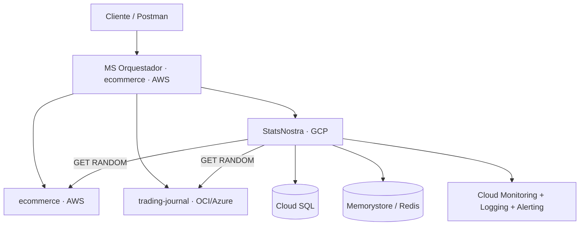

# 🏆 StatsNostra

API RESTful de predicciones deportivas. Los usuarios (apostadores) predicen
el marcador de partidos y acumulan puntos según qué tan acertada haya sido
su predicción una vez el partido finaliza.

**v1**
<p>
  
  
  
  
  
  
  
  
</p>

**v2**
<p>
  
  
  
  
  
</p>

**GitHub Actions** aparece en las dos: `pruebas.yml`/`produccion.yml` (v1 → Render) y `despliegue-gke.yml` (v2 → GKE).

## 🔗 Enlaces en vivo

| | Ambiente | URL |
|---|---|---|
| ☸️ | **GKE** — API (v1 + v2) | [34.57.56.128](http://34.57.56.128) |
| 🟢 | **Pruebas** — API (Render, solo v1) | [statsnostra-pruebas.onrender.com](https://statsnostra-pruebas.onrender.com) |
| 📘 | **Pruebas** — Swagger | [statsnostra-pruebas.onrender.com/docs](https://statsnostra-pruebas.onrender.com/docs) |
| 🔵 | **Producción** — API (Render, solo v1) | [statsnostra-produccion.onrender.com](https://statsnostra-produccion.onrender.com) |
| 📘 | **Producción** — Swagger | [statsnostra-produccion.onrender.com/docs](https://statsnostra-produccion.onrender.com/docs) |
| 🐙 | **Repositorio** | [github.com/MarianaPineda0/StatsNostra](https://github.com/MarianaPineda0/StatsNostra) |

## ☸️ Arquitectura multicloud

| API | Nube | Componente transversal |
|---|---|---|
| StatsNostra (esta) | Google Cloud — GKE | Caché Distribuida (Memorystore / Redis) |
| trading-journal | Oracle Cloud (datos) + Azure AKS (cómputo) | Object Storage |
| ecommerce | AWS — EKS | MS Orquestador + Cola/Tópico |



**StatsNostra en GCP:**
- Despliegue: GKE, 2 nodos, 2 réplicas, `HorizontalPodAutoscaler` (2-4, 70% CPU), probes de liveness/readiness, `requests`/`limits`, `ConfigMap` + `Secret` (ver [`k8s/`](k8s/)).
- `api/v1` y `api/v2`: CRUD completo para Apostador, Partido y Predicción. El `GetById` de `v2` agrega un `Trade` de trading-journal y un `Comercio` de ecommerce, en tiempo real, GET RANDOM, sin datos quemados.
- Trace-id: header `X-Trace-Id` (UUID), propagado en toda llamada saliente — confirmado end-to-end con trading-journal y con el orquestador.
- Caché Distribuida: Memorystore (Redis), TTL 30s sobre las respuestas de trading-journal y ecommerce.
- Observabilidad: Cloud Monitoring + Cloud Logging (JSON con `trace_id`) + alerta de 5xx a correo, probada con una falla real.
- Pipeline: GitHub Actions → Buildpacks (sin Dockerfile) → Artifact Registry → GKE, en cada push a `develop` ([`.github/workflows/despliegue-gke.yml`](.github/workflows/despliegue-gke.yml)).

### Servicios de GCP usados

| Servicio | Para qué |
|---|---|
| **Google Kubernetes Engine (GKE)** | Clúster (2 nodos), despliegue de la API con `Deployment`, `Service` y `HorizontalPodAutoscaler` |
| **Compute Engine** | VMs que forman los nodos del clúster GKE |
| **Cloud SQL (PostgreSQL)** | Base de datos, conectada desde el clúster vía sidecar (Cloud SQL Auth Proxy) |
| **Memorystore (Redis)** | Caché Distribuida de las respuestas de trading-journal y ecommerce |
| **Artifact Registry** | Almacena la imagen de la API construida con Buildpacks |
| **Cloud Build** | Construcción de imágenes con Buildpacks en pruebas manuales |
| **Cloud Logging** | Logs en JSON con `trace_id`, consultables por petición |
| **Cloud Monitoring** | Métricas nativas, y la alerta de 5xx a correo |
| **IAM + Workload Identity Federation** | Autenticación del pipeline de GitHub Actions sin llaves de servicio |

> ⏱️ Los servicios gratuitos de Render "duermen" tras 15 min de
> inactividad — la primera petición puede tardar ~50 s en responder
> mientras arrancan de nuevo. No es un error.

## 🎯 Objetivo

Proyecto de la materia **Énfasis I: DevOps**. `v1` es una API REST propia
con persistencia en PostgreSQL, dos ambientes independientes
(Pruebas/Producción) en Render con CI/CD en GitHub Actions. `v2` suma una
arquitectura multicloud junto con otras dos APIs del curso
(`trading-journal` en OCI/Azure, `ecommerce` en AWS) — esta API corre en
GKE (GCP), consume entidades reales de las otras dos en tiempo real,
propaga un trace-id entre las tres nubes, y agrega caché distribuida,
observabilidad y un pipeline de despliegue automático a Kubernetes.

## 🏗️ Arquitectura

Arquitectura por capas, cada una con una única responsabilidad:

```
app/
├── api/            # Rutas HTTP (FastAPI) y wiring de dependencias
│   ├── routes/     # v1 y v2, un archivo por entidad
│   └── dependencies.py
├── core/           # Configuración, excepciones, middleware, trace-id, logging, metricas
├── db/             # Conexión a PostgreSQL (engine, sesión)
├── integrations/   # Cliente HTTP hacia trading-journal/ecommerce y cache (v2)
├── models/         # Entidades de SQLAlchemy (tablas reales)
├── schemas/        # Validación de entrada/salida (Pydantic), v1 y v2
├── repositories/   # Acceso a datos (consultas SQL), sin reglas de negocio
├── services/       # Reglas de negocio y agregación v2
└── main.py         # Punto de entrada de la aplicación
```

Flujo de una petición: **ruta → servicio (valida reglas de negocio) →
repositorio (accede a la BD) → modelo (tabla real)**. Ninguna ruta accede a
la base de datos directamente, y ningún repositorio contiene reglas de
negocio — ver [`docs/arquitectura.md`](docs/arquitectura.md) para el
detalle completo.

## 🛠️ Tecnologías

**Base (v1):**

| Categoría | Tecnología |
|---|---|
| 🐍 Backend | Python 3.12, FastAPI, Uvicorn |
| 🐘 Base de datos | PostgreSQL 16/18 |
| 🔗 ORM | SQLAlchemy 2.x |
| 🗃️ Migraciones | Alembic |
| ✅ Validación | Pydantic v2 |
| 🧪 Testing | Pytest, pytest-cov |
| 🧹 Calidad | Ruff, Black |
| 🐳 Contenedores | Docker, Docker Compose |
| 🚀 CI/CD | GitHub Actions |
| ☁️ Cloud | Render (plan gratuito) |

**Multicloud (v2):**

| Categoría | Tecnología |
|---|---|
| ☁️ Cloud | Google Cloud Platform |
| ☸️ Orquestación | Kubernetes (GKE), `HorizontalPodAutoscaler` |
| 🐘 Base de datos | Cloud SQL (PostgreSQL), vía Cloud SQL Auth Proxy |
| ⚡ Caché | Redis (Memorystore) |
| 🌐 Cliente HTTP | httpx — llamadas en tiempo real a trading-journal y ecommerce |
| 📊 Métricas | Prometheus (`prometheus-fastapi-instrumentator`) |
| 📋 Logs y alertas | Cloud Logging, Cloud Monitoring |
| 📦 Build | Cloud Native Buildpacks (`pack`), sin Dockerfile |
| 🔑 Autenticación CI | Workload Identity Federation (sin llaves) |
| 🚀 CI/CD | GitHub Actions → GKE |

## 📦 Entidades y relaciones

Tres entidades del dominio, sin excepciones:

- 🙋 **Apostador** — usuario que registra predicciones (`nombre`, `username`
  único, `email` único, `activo`).
- ⚽ **Partido** — evento deportivo (`deporte`, `liga`, equipos, `estado`,
  resultados una vez finalizado).
- 🔮 **Predicción** — pronóstico de un apostador sobre un partido
  (`goles_local_pred`, `goles_visitante_pred`, `acertada`, `puntos`).

```
Apostador (1) ────< Predicción >──── (1) Partido
```

Un apostador puede tener muchas predicciones; un partido puede recibir
muchas predicciones; pero un mismo apostador solo puede predecir **una vez**
por partido (constraint `UNIQUE(apostador_id, partido_id)`).

## 📜 Reglas de negocio

1️⃣ No se puede predecir un partido ya finalizado.
2️⃣ El apostador debe existir.
3️⃣ El apostador debe estar activo.
4️⃣ El partido debe existir.
5️⃣ Un apostador no puede tener dos predicciones para el mismo partido.
6️⃣ Un partido no se puede finalizar dos veces.
7️⃣ Al finalizar un partido, se evalúan automáticamente todas sus predicciones.

**🏅 Sistema de puntos** (aplicado al finalizar un partido):

| Resultado de la predicción | Puntos |
|---|---|
| 🎯 Marcador exacto | 3 |
| ✅ Acierta el ganador (o empate), falla el marcador | 1 |
| ❌ Falla el ganador | 0 |

## 🌐 Endpoints

```
POST   /apostadores
GET    /apostadores
GET    /apostadores/{id}
PUT    /apostadores/{id}
PATCH  /apostadores/{id}
DELETE /apostadores/{id}

POST   /partidos
GET    /partidos
GET    /partidos/{id}
PUT    /partidos/{id}
PATCH  /partidos/{id}
DELETE /partidos/{id}
POST   /partidos/{id}/finalizar

POST   /predicciones
GET    /predicciones
GET    /predicciones/{id}
PUT    /predicciones/{id}
PATCH  /predicciones/{id}
DELETE /predicciones/{id}
```

PUT y PATCH usan el mismo handler y el mismo schema de actualización (todos los
campos opcionales), así que ambos aceptan una actualización parcial —
solo se distinguen por el verbo HTTP.

## 🌍 v1 vs v2

Los endpoints de arriba también están disponibles bajo `/api/v1/...`
(alias, mismo código, misma lógica) — convención de versionado acordada
con el grupo. `/api/v2` es una versión nueva y separada, no un reemplazo.

| | `v1` | `v2` |
|---|---|---|
| Prefijo | `/apostadores` · `/api/v1/apostadores` | `/api/v2/apostadores` |
| Crear, listar, actualizar, eliminar | ✅ | ✅ idéntico a `v1`, sin agregación |
| `GET /{id}` | Solo tu propia entidad | Tu entidad **+** un `Trade` de `trading-journal` **+** un `Comercio` de `ecommerce`, obtenidos en tiempo real |
| Origen del dato externo | — | Registro al azar de la lista del compañero (GET RANDOM) — nunca fijo, nunca quemado |
| Si el compañero está caído | — | El campo sale en `null`; tu API no se cae |
| Caché | — | Respuesta externa cacheada 30s (Redis) antes de volver a llamar |

```
GET /api/v2/apostadores/{id}
GET /api/v2/partidos/{id}
GET /api/v2/predicciones/{id}
```

**Ejemplo real, `GET /api/v2/apostadores/7`:**
```json
{
  "apostador": {"id": 7, "nombre": "Mariana Pineda", "username": "mari_pine", "email": "mariana@gmail.com", "activo": true},
  "trading_journal_trade": {"id": 21, "contract": "MNQU26", "direction": "LONG", "size": 1, "open": true},
  "ecommerce_comercio": {"nit": 238479238, "legalName": "Amazon S.A", "email": "amazon@amazon.com"}
}
```

### 🔍 Método QUERY

Además del CRUD estándar, la API implementa el verbo HTTP **QUERY** real
(no un `GET` disfrazado) para lecturas compuestas:

```
QUERY /query/apostadores/{id}/predicciones
QUERY /query/partidos/{id}/predicciones
QUERY /query/apostadores/{id}/estadisticas
QUERY /query/apostadores/ranking
QUERY /query/partidos/finalizados
QUERY /query/partidos?deporte=...&liga=...
```

Como algunas redes (incluida la de Render, verificado con evidencia — ver
[`docs/pruebas.md`](docs/pruebas.md)) bloquean métodos HTTP no estándar en
su capa de borde, estos mismos endpoints también aceptan `POST` con el
header `X-HTTP-Method-Override: QUERY` como mecanismo de compatibilidad,
sin que el verbo QUERY real deje de existir en el código.

## 🐘 PostgreSQL y Alembic

Persistencia real en PostgreSQL — no se usa `Base.metadata.create_all()`
como mecanismo de creación de tablas en ningún ambiente; todo el esquema se
gestiona con migraciones de Alembic (`migrations/versions/`).

## 🐳 Docker (desarrollo local)

```bash
docker compose up --build
```

Levanta la API y PostgreSQL juntos, aplica las migraciones automáticamente,
y deja la API disponible en `http://localhost:8000`. Detalle completo en
[`docs/docker.md`](docs/docker.md).

`Dockerfile` y `docker-compose.yml` son para correr el proyecto en tu
máquina; el despliegue en GKE no los usa — la imagen se construye con
Buildpacks (ver CI/CD abajo).

## ⚙️ Instalación y ejecución local

**Con Docker (recomendado):**
```bash
git clone https://github.com/MarianaPineda0/StatsNostra.git
cd StatsNostra
cp .env.example .env
docker compose up --build
```

**Sin Docker (entorno virtual local):**
```bash
python -m venv .venv
.venv\Scripts\activate          # Windows
pip install -r requirements-dev.txt
docker compose up -d db         # solo la base de datos
alembic upgrade head
uvicorn app.main:app --reload
```

- 📘 Swagger UI: http://localhost:8000/docs
- 📕 ReDoc: http://localhost:8000/redoc

## 🔐 Variables de entorno

Ver [`.env.example`](.env.example) para la lista completa. `.env` nunca se
versiona (está en `.gitignore`); solo se versiona `.env.example` con
nombres de variables, sin valores reales.

## 🧪 Testing y cobertura

```bash
pytest -v
pytest --cov=app --cov-report=term-missing
```

Los pipelines de `v1` (`pruebas.yml`/`produccion.yml`) corren estas pruebas
en cada push, pero ya sin gate mínimo de cobertura — no es un requisito de
esta entrega, se quitó para no bloquear despliegues por algo que no se
evalúa.

46 pruebas automatizadas, corriendo contra PostgreSQL real (no mocks),
cubriendo la lógica de `v1` (el código nuevo de `v2` no tiene pruebas
propias — no es un requisito de esta entrega). Detalle completo en
[`docs/pruebas.md`](docs/pruebas.md).

## 🚀 CI/CD

Tres pipelines en GitHub Actions:

| Pipeline | Rama | Qué hace |
|---|---|---|
| ⚙️ `pruebas.yml` | `develop` | Pruebas + lint → despliegue a Render |
| ⚙️ `produccion.yml` | `main` | Pruebas + lint → despliegue a Render |
| ☸️ `despliegue-gke.yml` | `develop` | Build con Buildpacks → Artifact Registry → despliegue automático a GKE |

`despliegue-gke.yml` se autentica sin llaves (Workload Identity Federation)
y construye la imagen sin Cloud Build ni Docker: usa `pack` directo en el
runner, publica en Artifact Registry, y actualiza el `Deployment` en el
clúster (`kubectl set image` + `rollout status`). Ver [`docs/ci-cd.md`](docs/ci-cd.md)
para el detalle de los pipelines de Render.

## ☁️ Ambientes (Render)

Dos Web Services independientes, cada uno con su propia base de datos
PostgreSQL (aisladas entre sí: `CONNECT` revocado de `PUBLIC`, un rol de
BD distinto por ambiente):

| Ambiente | Rama | URL |
|---|---|---|
| 🟢 Pruebas | `develop` | [statsnostra-pruebas.onrender.com](https://statsnostra-pruebas.onrender.com) |
| 🔵 Producción | `main` | [statsnostra-produccion.onrender.com](https://statsnostra-produccion.onrender.com) |

Detalle completo de la infraestructura en [`docs/render.md`](docs/render.md).

## 📚 Documentación adicional

- 🏗️ [`docs/arquitectura.md`](docs/arquitectura.md)
- 🐳 [`docs/docker.md`](docs/docker.md)
- 🚀 [`docs/ci-cd.md`](docs/ci-cd.md)
- ☁️ [`docs/render.md`](docs/render.md)
- 🧪 [`docs/pruebas.md`](docs/pruebas.md)
- ☸️ [`k8s/`](k8s/) — manifiestos de GKE
