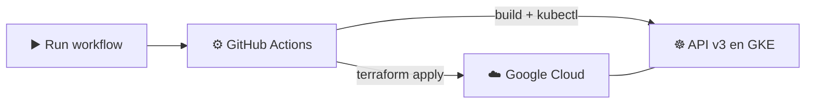
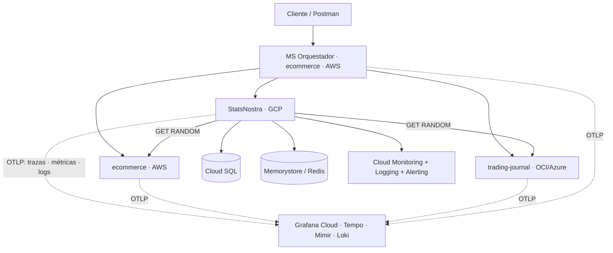

# 🏆 StatsNostra

API RESTful de predicciones deportivas. Los usuarios (apostadores) predicen
el marcador de partidos y acumulan puntos según qué tan acertada haya sido
su predicción una vez el partido finaliza.

**v1**
<p>
  
  
  
  
  
  
  
  
</p>

**v2**
<p>
  
  
  
  
  
  
</p>

**v3**
<p>
  
  
  
  
  
  
</p>

**GitHub Actions** aparece en las tres: `pruebas.yml`/`produccion.yml` (v1 → Render), `despliegue-gke.yml` (v2 → GKE, retirado en la v3) y `terraform-v3-despliegue.yml`/`terraform-v3-destruir.yml` (v3 → infraestructura con Terraform).

## 🔗 Enlaces en vivo

| | Ambiente | URL |
|---|---|---|
| ☸️ | **GKE (v3)** — API (v1 + v2) | La IP la entrega el workflow `Despliegue v3 con Terraform` en su resumen; la infraestructura se destruye al terminar la sustentación |
| 🏗️ | **Infraestructura v3** — Terraform | [`terraform/`](terraform/) |
| 🟢 | **Pruebas** — API (Render, solo v1) | [statsnostra-pruebas.onrender.com](https://statsnostra-pruebas.onrender.com) |
| 📘 | **Pruebas** — Swagger | [statsnostra-pruebas.onrender.com/docs](https://statsnostra-pruebas.onrender.com/docs) |
| 🔵 | **Producción** — API (Render, solo v1) | [statsnostra-produccion.onrender.com](https://statsnostra-produccion.onrender.com) |
| 📘 | **Producción** — Swagger | [statsnostra-produccion.onrender.com/docs](https://statsnostra-produccion.onrender.com/docs) |
| 📊 | **Grafana Cloud** — Dashboard multicloud | [Multicloud - Observabilidad unificada](https://sturdyanchovy2072.grafana.net/d/mp8kfcm/multicloud-observabilidad-unificada) |
| 🚨 | **Grafana Cloud** — Alertas | [Reglas de alerta](https://sturdyanchovy2072.grafana.net/alerting/list) |
| 🐙 | **Repositorio** | [github.com/MarianaPineda0/StatsNostra](https://github.com/MarianaPineda0/StatsNostra) |

## 🏗️ Infraestructura como código (v3)

En la v3 la infraestructura de Google Cloud deja de crearse a mano: **Terraform**
la define en código y un pipeline la despliega e instala el API encima.



| Servicio de GCP | Archivo | Rol en la solución |
|---|---|---|
| ☸️ GKE | `gke.tf` | Ejecuta el API |
| 🐘 Cloud SQL (PostgreSQL 16) | `cloudsql.tf` | Base de datos `statsnostra_v3` |
| ⚡ Memorystore (Redis) | `redis.tf` | Caché de las respuestas |
| 📦 Artifact Registry | `artifact_registry.tf` | Imágenes Docker |
| 📍 IP externa estática | `ip.tf` | Dirección fija del API |
| 🔐 Secret Manager | `secretos.tf` | Contraseña de la base de datos |

- **Desplegar:** Actions → `Despliegue v3 con Terraform` → *Run workflow*.
- **Destruir:** Actions → `Destrucción v3 con Terraform` → escribir `DESTRUIR`.
- **Guía completa** (estado remoto, comandos manuales, outputs): [`terraform/README.md`](terraform/README.md).

**Alcance de la v3:** esta entrega pide infraestructura como código, no
observabilidad ni integración con las APIs de los compañeros. Por eso el
despliegue de Terraform solo crea el mínimo (con Redis) y no configura
Grafana Cloud ni las URLs de trading-journal y ecommerce. El código de la API
(`v2`, caché, OpenTelemetry) sigue en el repositorio y queda inactivo cuando
esas variables no están definidas. El pipeline de la v2 (`despliegue-gke.yml`)
se retiró porque lo reemplazan los workflows de Terraform.

## ☸️ Arquitectura multicloud

| API | Integrante que la opera | Nube | Componente transversal |
|---|---|---|---|
| StatsNostra (esta) | Mariana Pineda | Google Cloud — GKE | Caché Distribuida (Memorystore / Redis) |
| trading-journal | Juan Pablo Ramírez | Oracle Cloud (datos) + Azure AKS (cómputo) | Object Storage |
| ecommerce | Juan Felipe Palacio | AWS — EKS | MS Orquestador + Cola/Tópico |



**StatsNostra en GCP:**
- Despliegue: GKE, 2 nodos, 2-4 réplicas, `HorizontalPodAutoscaler` (2-4, 70% CPU) — **escalamiento probado con carga real** contra el LoadBalancer (2→4 réplicas, evidencia en eventos de Kubernetes), probes de liveness/readiness, `requests`/`limits`, `ConfigMap` + `Secret` (ver [`k8s/`](k8s/)).
- `api/v1` y `api/v2`: CRUD completo para Apostador, Partido y Predicción. El `GetById` de `v2` agrega un `Trade` de trading-journal y un `Comercio` de ecommerce, en tiempo real, consumiendo el **`api/v2`** de cada compañero (contratos versionados), GET RANDOM, sin datos quemados.
- Trace-id: header `X-Trace-Id` (UUID), propagado en toda llamada saliente — confirmado end-to-end con trading-journal y con el orquestador.
- Caché Distribuida: Memorystore (Redis), TTL 30s sobre las respuestas de trading-journal y ecommerce, más **invalidación explícita** vía `DELETE /api/v2/cache/{entidad}` (fuera del TTL).
- Datos de ejemplo: la BD de Cloud SQL tiene 3 apostadores, 5 partidos y 14 predicciones (uno de los partidos ya finalizado, con sus predicciones evaluadas). Se cargaron por la propia API (`POST`), no están en el código; así, cuando otra API pide una entidad de esta al azar (GET RANDOM) recibe datos y no `null`.
- Observabilidad: ver sección dedicada abajo.
- Pipeline: GitHub Actions → Buildpacks (sin Dockerfile) → Artifact Registry → GKE, en cada push a `develop` ([`.github/workflows/despliegue-gke.yml`](.github/workflows/despliegue-gke.yml)).

### 📊 Observabilidad

Dos capas, como pide la rúbrica: monitoreo nativo de la nube propia, y una
herramienta SAAS transversal compartida por las tres nubes del equipo.

**Nativo (GCP):**
- Cloud Logging (logs JSON con `trace_id`, activo por defecto en el clúster).
- Cloud Monitoring con Managed Prometheus (métricas de infraestructura).
- Log-based metric `statsnostra_errores_5xx` + alerta a correo, con canal de
  notificación configurado — probada con una falla real.

**Transversal (Grafana Cloud, compartido con el equipo vía OTLP):**
- **Trazas**: `OTLPSpanExporter`, instrumentación automática de FastAPI y
  httpx (`app/core/tracing.py`) — se ve en Tempo junto con las trazas de
  `trading-journal` (mismo org de Grafana Cloud, ya reportando como
  `api-oci`).
- **Métricas**: RED (tasa de peticiones, errores, p50/p95) vía
  auto-instrumentación de OTel, más métricas propias (`statsnostra_cache_aciertos`/`_fallos`) expuestas por la API de métricas de OTel — no
  `prometheus_client` — para viajar por el mismo exportador OTLP sin
  depender de que algo scrapee `/metrics` dentro del clúster.
- **Logs**: exportados también por OTLP a Grafana Loki (`LoggingHandler` de
  OTel agregado al logger raíz y a los de `uvicorn`), con el trace-id de
  negocio (`X-Trace-Id`) como atributo estructurado (`trace_id_negocio`)
  para poder correlacionar entre nubes sin depender solo de Cloud Logging.
- **Alerta**: regla en Grafana Alerting sobre tasa de errores 5xx,
  verificada end-to-end (disparo real + entrega de email confirmada)
  inyectando un valor sintético en la condición, sin afectar el tráfico
  real del clúster.
- **Dashboard unificado** ([abrir](https://sturdyanchovy2072.grafana.net/d/mp8kfcm/multicloud-observabilidad-unificada)):
  un solo tablero compartido por los tres integrantes en el mismo org de
  Grafana Cloud (acceso Editor), organizado en una fila por servicio
  (`api-gcp`, `api-oci`, `api-aws` + `orchestrator`). La fila de `api-gcp`
  incluye:
  - **RED por endpoint de `/api/v2`**: tasa de peticiones, errores (5xx
    y 4xx), latencia p50 y p95, agrupados por ruta (`http_target`).
  - **Caché**: aciertos y fallos por segundo, *hit ratio* y totales.
  - **Trazas**: recientes de todas las nubes, y un panel que filtra solo las
    que traen spans de `api-gcp`, `api-oci` y `api-aws` a la vez.
  - **Logs** (Loki) filtrables con la variable `trace_id` (el
    `X-Trace-Id` de negocio); cada log trae además el `trace_id` nativo de
    OTel para saltar a la traza en Tempo.
  - **Estado de las alertas** de Grafana.

  Cada stack expone nombres de métricas distintos (OTel/Python, Micrometer/Spring
  en OCI, OTel/Node en AWS), por eso las filas de métricas son una por
  servicio y no una sola query; lo que sí es realmente común a las tres
  nubes son las trazas.
- **Traza extremo a extremo entre las tres nubes** (verificada en Tempo): una
  sola petición `GET /api/v2/apostadores/7` produce **una sola traza** con
  spans de `api-gcp`, `api-oci` y `api-aws`; las trazas que empiezan en el
  `orchestrator` incluyen además a los tres. La propagación usa el contexto
  W3C de OTel (httpx en esta API) más el header `X-Trace-Id` de negocio.

#### 📈 Métricas de esta API (detalle)

Salen por OTLP cada 30 s hacia Grafana Cloud (Mimir), con `service_name="api-gcp"`.
Las HTTP vienen de la auto-instrumentación de FastAPI y httpx; las de caché son
contadores propios creados con la API de métricas de OTel
([`app/core/metrics.py`](app/core/metrics.py)).

| Métrica | Tipo | Labels útiles | Qué mide |
|---|---|---|---|
| `http_server_duration_milliseconds_{bucket,count,sum}` | Histograma | `http_target`, `http_method`, `http_status_code` | Volumen y latencia de cada endpoint; base de las métricas RED |
| `http_server_active_requests` | Gauge | `http_method`, `http_host` | Peticiones en curso |
| `http_server_request_size_bytes_*` / `http_server_response_size_bytes_*` | Histograma | `http_target`, `http_status_code` | Tamaño de las peticiones y respuestas |
| `http_client_duration_milliseconds_*` | Histograma | `http_method`, `http_status_code` | Latencia de las llamadas salientes hacia los compañeros (el destino se ve en las trazas, no en esta métrica) |
| `statsnostra_cache_aciertos_total` | Contador | — | Lecturas servidas desde Redis |
| `statsnostra_cache_fallos_total` | Contador | — | Lecturas que fueron a la API del compañero |

`http_target` guarda la ruta con plantilla (por ejemplo
`/api/v2/partidos/{partido_id}`), así que el RED sale por endpoint y no por id.

Consultas que usan los paneles y la alerta:

| Panel | PromQL |
|---|---|
| Tasa de peticiones por endpoint | `sum by(http_target)(rate(http_server_duration_milliseconds_count{service_name="api-gcp", http_target=~"/api/v2/.*"}[$__rate_interval]))` |
| Errores 5xx | `sum(rate(http_server_duration_milliseconds_count{service_name="api-gcp", http_target=~"/api/v2/.*", http_status_code=~"5.."}[$__rate_interval])) or vector(0)` |
| Errores 4xx por endpoint | igual, con `http_status_code=~"4.."` y `sum by(http_target)` |
| Latencia p50 / p95 por endpoint | `histogram_quantile(0.95, sum by(le, http_target)(rate(http_server_duration_milliseconds_bucket{service_name="api-gcp", http_target=~"/api/v2/.*"}[$__rate_interval])))` (0.5 para p50) |
| Caché, aciertos y fallos por segundo | `sum(rate(statsnostra_cache_aciertos_total[$__rate_interval]))` y su equivalente de `fallos` |
| Hit ratio | `sum(increase(statsnostra_cache_aciertos_total[$__range])) / (sum(increase(statsnostra_cache_aciertos_total[$__range])) + sum(increase(statsnostra_cache_fallos_total[$__range])))` |
| Alerta 5xx | `sum(increase(http_server_duration_milliseconds_count{service_name="api-gcp", http_status_code=~"5.."}[5m])) > 0`, evaluada cada minuto y notificada por correo |

Cada integrante mantiene su propia fila del dashboard con las métricas de su
stack.

#### 🔗 Correlación entre nubes

Un mismo mensaje se puede seguir de punta a punta con dos identificadores que
se propagan juntos:

1. **`X-Trace-Id` (negocio).** `TraceIdMiddleware` lo toma de la petición
   entrante, o genera un UUID, y lo deja disponible durante toda la petición.
   Se devuelve en la respuesta y el cliente HTTP
   ([`app/integrations/cliente_externo.py`](app/integrations/cliente_externo.py))
   lo reenvía en cada llamada saliente hacia trading-journal y ecommerce.
2. **Contexto de traza W3C (OTel).** La instrumentación de httpx inyecta
   `traceparent` en esas mismas llamadas, de modo que los spans de las otras APIs
   se unen a la misma traza. Verificado en Tempo: una petición a
   `GET /api/v2/apostadores/7` genera **una traza con spans de `api-gcp`,
   `api-oci` y `api-aws`**.
3. **Logs.** Cada línea sale en JSON por stdout (Cloud Logging) y por OTLP
   (Loki) con el `trace_id` nativo de OTel y el `trace_id_negocio`
   (`X-Trace-Id`), lo que permite saltar del log a la traza y de la traza a los
   logs.

Consultas de ejemplo:

```
# Tempo (TraceQL): trazas que pasan por las tres nubes
{resource.service.name="api-gcp"} && {resource.service.name="api-oci"} && {resource.service.name="api-aws"}

# Loki (LogQL): todos los logs de un mensaje
{service_name="api-gcp"} | trace_id_negocio="demo-001"
```

### 🎬 Demostración en vivo

Base: `http://34.57.56.128`.

1. **Flujo entre nubes y trace-id.**
   `curl -H "X-Trace-Id: demo-001" http://34.57.56.128/api/v2/apostadores/7`
   devuelve el apostador más un `Trade` (OCI) y un `Comercio` (AWS) reales. En
   el dashboard, el panel de trazas que cruzan las tres nubes muestra la traza
   y el panel de logs, con `trace_id = demo-001`, sus líneas.
2. **Modificar un dato en tiempo real.**
   `PATCH /api/v2/apostadores/7` con `{"nombre":"..."}` y luego `GET` del mismo
   id refleja el cambio. Para los datos de los compañeros, la caché retiene
   30 s; `DELETE /api/v2/cache/ecommerce` (o `trading_journal`) fuerza a traer
   el dato nuevo en la siguiente petición.
3. **Escalamiento del clúster.** Generar carga
   (`for i in $(seq 1 15); do (while true; do curl -s -o /dev/null http://34.57.56.128/api/v2/apostadores/7; done) & done`)
   y observar `kubectl get hpa statsnostra-api-hpa -w` y
   `kubectl get pods -l app=statsnostra-api`: pasa de 2 a 4 réplicas al superar
   el 70 % de CPU. Detener la carga con `kill $(jobs -p)`.
4. **Disparo de la alerta.** En Grafana → regla *StatsNostra api-gcp: errores 5xx*,
   reemplazar temporalmente la query por `vector(1)`: la regla pasa a *Firing* y
   llega el correo a `email-mariana`. Después se restaura la query original
   (`sum(increase(http_server_duration_milliseconds_count{service_name="api-gcp", http_status_code=~"5.."}[5m]))`).
   La alerta nativa de Cloud Monitoring se dispara con 5xx reales.

### Servicios de GCP usados

| Servicio | Para qué |
|---|---|
| **Google Kubernetes Engine (GKE)** | Clúster (2 nodos), despliegue de la API con `Deployment`, `Service` y `HorizontalPodAutoscaler` |
| **Compute Engine** | VMs que forman los nodos del clúster GKE |
| **Cloud SQL (PostgreSQL)** | Base de datos, conectada desde el clúster vía sidecar (Cloud SQL Auth Proxy) |
| **Memorystore (Redis)** | Caché Distribuida de las respuestas de trading-journal y ecommerce |
| **Artifact Registry** | Almacena la imagen de la API construida con Buildpacks |
| **Cloud Build** | Construcción de imágenes con Buildpacks en pruebas manuales |
| **Cloud Logging** | Logs en JSON con `trace_id`, consultables por petición |
| **Cloud Monitoring** | Métricas nativas, y la alerta de 5xx a correo |
| **IAM + Workload Identity Federation** | Autenticación del pipeline de GitHub Actions sin llaves de servicio |

> ⏱️ Los servicios gratuitos de Render "duermen" tras 15 min de
> inactividad — la primera petición puede tardar ~50 s en responder
> mientras arrancan de nuevo. No es un error.

## 🎯 Objetivo

Proyecto de la materia **Énfasis I: DevOps**. `v1` es una API REST propia
con persistencia en PostgreSQL, dos ambientes independientes
(Pruebas/Producción) en Render con CI/CD en GitHub Actions. `v2` suma una
arquitectura multicloud junto con otras dos APIs del curso
(`trading-journal` en OCI/Azure, `ecommerce` en AWS) — esta API corre en
GKE (GCP), consume entidades reales de las otras dos en tiempo real,
propaga un trace-id entre las tres nubes, y agrega caché distribuida,
observabilidad y un pipeline de despliegue automático a Kubernetes.

## 🏗️ Arquitectura

Arquitectura por capas, cada una con una única responsabilidad:

```
app/
├── api/            # Rutas HTTP (FastAPI) y wiring de dependencias
│   ├── routes/     # v1 y v2, un archivo por entidad
│   └── dependencies.py
├── core/           # Configuración, excepciones, middleware, trace-id, logging, metricas
├── db/             # Conexión a PostgreSQL (engine, sesión)
├── integrations/   # Cliente HTTP hacia trading-journal/ecommerce y cache (v2)
├── models/         # Entidades de SQLAlchemy (tablas reales)
├── schemas/        # Validación de entrada/salida (Pydantic), v1 y v2
├── repositories/   # Acceso a datos (consultas SQL), sin reglas de negocio
├── services/       # Reglas de negocio y agregación v2
└── main.py         # Punto de entrada de la aplicación
```

Flujo de una petición: **ruta → servicio (valida reglas de negocio) →
repositorio (accede a la BD) → modelo (tabla real)**. Ninguna ruta accede a
la base de datos directamente, y ningún repositorio contiene reglas de
negocio — ver [`docs/arquitectura.md`](docs/arquitectura.md) para el
detalle completo.

## 🛠️ Tecnologías

**Base (v1):**

| Categoría | Tecnología |
|---|---|
| 🐍 Backend | Python 3.12, FastAPI, Uvicorn |
| 🐘 Base de datos | PostgreSQL 16/18 |
| 🔗 ORM | SQLAlchemy 2.x |
| 🗃️ Migraciones | Alembic |
| ✅ Validación | Pydantic v2 |
| 🧪 Testing | Pytest, pytest-cov |
| 🧹 Calidad | Ruff, Black |
| 🐳 Contenedores | Docker, Docker Compose |
| 🚀 CI/CD | GitHub Actions |
| ☁️ Cloud | Render (plan gratuito) |

**Multicloud (v2):**

| Categoría | Tecnología |
|---|---|
| ☁️ Cloud | Google Cloud Platform |
| ☸️ Orquestación | Kubernetes (GKE), `HorizontalPodAutoscaler` |
| 🐘 Base de datos | Cloud SQL (PostgreSQL), vía Cloud SQL Auth Proxy |
| ⚡ Caché | Redis (Memorystore) |
| 🌐 Cliente HTTP | httpx — llamadas en tiempo real a `api/v2` de trading-journal y ecommerce |
| 📊 Trazas y métricas | OpenTelemetry (auto-instrumentación FastAPI/httpx) → Grafana Cloud (Tempo + Mimir) vía OTLP |
| 📋 Logs | Cloud Logging (nativo) + Grafana Loki (OTLP) |
| 🔔 Alertas | Cloud Monitoring (5xx → correo) + Grafana Alerting (5xx, probada end-to-end) |
| 📦 Build | Cloud Native Buildpacks (`pack`), sin Dockerfile |
| 🔑 Autenticación CI | Workload Identity Federation (sin llaves) |
| 🚀 CI/CD | GitHub Actions → GKE |

## 📦 Entidades y relaciones

Tres entidades del dominio, sin excepciones:

- 🙋 **Apostador** — usuario que registra predicciones (`nombre`, `username`
  único, `email` único, `activo`).
- ⚽ **Partido** — evento deportivo (`deporte`, `liga`, equipos, `estado`,
  resultados una vez finalizado).
- 🔮 **Predicción** — pronóstico de un apostador sobre un partido
  (`goles_local_pred`, `goles_visitante_pred`, `acertada`, `puntos`).

```
Apostador (1) ────< Predicción >──── (1) Partido
```

Un apostador puede tener muchas predicciones; un partido puede recibir
muchas predicciones; pero un mismo apostador solo puede predecir **una vez**
por partido (constraint `UNIQUE(apostador_id, partido_id)`).

## 📜 Reglas de negocio

1️⃣ No se puede predecir un partido ya finalizado.
2️⃣ El apostador debe existir.
3️⃣ El apostador debe estar activo.
4️⃣ El partido debe existir.
5️⃣ Un apostador no puede tener dos predicciones para el mismo partido.
6️⃣ Un partido no se puede finalizar dos veces.
7️⃣ Al finalizar un partido, se evalúan automáticamente todas sus predicciones.

**🏅 Sistema de puntos** (aplicado al finalizar un partido):

| Resultado de la predicción | Puntos |
|---|---|
| 🎯 Marcador exacto | 3 |
| ✅ Acierta el ganador (o empate), falla el marcador | 1 |
| ❌ Falla el ganador | 0 |

## 🌐 Endpoints

```
POST   /apostadores
GET    /apostadores
GET    /apostadores/{id}
PUT    /apostadores/{id}
PATCH  /apostadores/{id}
DELETE /apostadores/{id}

POST   /partidos
GET    /partidos
GET    /partidos/{id}
PUT    /partidos/{id}
PATCH  /partidos/{id}
DELETE /partidos/{id}
POST   /partidos/{id}/finalizar

POST   /predicciones
GET    /predicciones
GET    /predicciones/{id}
PUT    /predicciones/{id}
PATCH  /predicciones/{id}
DELETE /predicciones/{id}
```

PUT y PATCH usan el mismo handler y el mismo schema de actualización (todos los
campos opcionales), así que ambos aceptan una actualización parcial —
solo se distinguen por el verbo HTTP.

## 🌍 v1 vs v2

Los endpoints de arriba también están disponibles bajo `/api/v1/...`
(alias, mismo código, misma lógica) — convención de versionado acordada
con el grupo. `/api/v2` es una versión nueva y separada, no un reemplazo.

| | `v1` | `v2` |
|---|---|---|
| Prefijo | `/apostadores` · `/api/v1/apostadores` | `/api/v2/apostadores` |
| Crear, listar, actualizar, eliminar | ✅ | ✅ idéntico a `v1`, sin agregación |
| `GET /{id}` | Solo tu propia entidad | Tu entidad **+** un `Trade` de `trading-journal` **+** un `Comercio` de `ecommerce`, obtenidos en tiempo real |
| Origen del dato externo | — | Registro al azar del `api/v2` del compañero (GET RANDOM) — nunca fijo, nunca quemado |
| Si el compañero está caído | — | El campo sale en `null`; tu API no se cae |
| Caché | — | Respuesta externa cacheada 30s (Redis) antes de volver a llamar |
| Invalidación de caché | — | `DELETE /api/v2/cache/{entidad}` (`trading_journal` \| `ecommerce`), fuera del TTL |

```
GET    /api/v2/apostadores/{id}
GET    /api/v2/partidos/{id}
GET    /api/v2/predicciones/{id}
DELETE /api/v2/cache/{entidad}      # entidad: trading_journal | ecommerce
```

**Ejemplo real, `GET /api/v2/apostadores/7`:**
```json
{
  "apostador": {"id": 7, "nombre": "Mariana Pineda", "username": "mari_pine", "email": "mariana@gmail.com", "activo": true},
  "trading_journal_trade": {"id": 21, "contract": "MNQU26", "direction": "LONG", "size": 1, "open": true},
  "ecommerce_comercio": {"nit": 238479238, "legalName": "Amazon S.A", "email": "amazon@amazon.com"}
}
```

### 🔍 Método QUERY

Además del CRUD estándar, la API implementa el verbo HTTP **QUERY** real
(no un `GET` disfrazado) para lecturas compuestas:

```
QUERY /query/apostadores/{id}/predicciones
QUERY /query/partidos/{id}/predicciones
QUERY /query/apostadores/{id}/estadisticas
QUERY /query/apostadores/ranking
QUERY /query/partidos/finalizados
QUERY /query/partidos?deporte=...&liga=...
```

Como algunas redes (incluida la de Render, verificado con evidencia — ver
[`docs/pruebas.md`](docs/pruebas.md)) bloquean métodos HTTP no estándar en
su capa de borde, estos mismos endpoints también aceptan `POST` con el
header `X-HTTP-Method-Override: QUERY` como mecanismo de compatibilidad,
sin que el verbo QUERY real deje de existir en el código.

## 🐘 PostgreSQL y Alembic

Persistencia real en PostgreSQL — no se usa `Base.metadata.create_all()`
como mecanismo de creación de tablas en ningún ambiente; todo el esquema se
gestiona con migraciones de Alembic (`migrations/versions/`).

## 🐳 Docker (desarrollo local)

```bash
docker compose up --build
```

Levanta la API y PostgreSQL juntos, aplica las migraciones automáticamente,
y deja la API disponible en `http://localhost:8000`. Detalle completo en
[`docs/docker.md`](docs/docker.md).

`Dockerfile` y `docker-compose.yml` son para correr el proyecto en tu
máquina; el despliegue en GKE no los usa — la imagen se construye con
Buildpacks (ver CI/CD abajo).

## ⚙️ Instalación y ejecución local

**Con Docker (recomendado):**
```bash
git clone https://github.com/MarianaPineda0/StatsNostra.git
cd StatsNostra
cp .env.example .env
docker compose up --build
```

**Sin Docker (entorno virtual local):**
```bash
python -m venv .venv
.venv\Scripts\activate          # Windows
pip install -r requirements-dev.txt
docker compose up -d db         # solo la base de datos
alembic upgrade head
uvicorn app.main:app --reload
```

- 📘 Swagger UI: http://localhost:8000/docs
- 📕 ReDoc: http://localhost:8000/redoc

## 🔐 Variables de entorno

Ver [`.env.example`](.env.example) para la lista completa. `.env` nunca se
versiona (está en `.gitignore`); solo se versiona `.env.example` con
nombres de variables, sin valores reales.

## 🧪 Testing y cobertura

```bash
pytest -v
pytest --cov=app --cov-report=term-missing
```

Los pipelines de `v1` (`pruebas.yml`/`produccion.yml`) corren estas pruebas
en cada push, pero ya sin gate mínimo de cobertura — no es un requisito de
esta entrega, se quitó para no bloquear despliegues por algo que no se
evalúa.

46 pruebas automatizadas, corriendo contra PostgreSQL real (no mocks),
cubriendo la lógica de `v1` (el código nuevo de `v2` no tiene pruebas
propias — no es un requisito de esta entrega). Detalle completo en
[`docs/pruebas.md`](docs/pruebas.md).

## 🚀 CI/CD

Tres pipelines en GitHub Actions:

| Pipeline | Rama | Qué hace |
|---|---|---|
| ⚙️ `pruebas.yml` | `develop` | Pruebas + lint → despliegue a Render |
| ⚙️ `produccion.yml` | `main` | Pruebas + lint → despliegue a Render |
| ☸️ `despliegue-gke.yml` | `develop` | Build con Buildpacks → Artifact Registry → despliegue automático a GKE |

`despliegue-gke.yml` se autentica sin llaves (Workload Identity Federation)
y construye la imagen sin Cloud Build ni Docker: usa `pack` directo en el
runner, publica en Artifact Registry, y actualiza el `Deployment` en el
clúster (`kubectl set image` + `rollout status`). Ver [`docs/ci-cd.md`](docs/ci-cd.md)
para el detalle de los pipelines de Render.

## ☁️ Ambientes (Render)

Dos Web Services independientes, cada uno con su propia base de datos
PostgreSQL (aisladas entre sí: `CONNECT` revocado de `PUBLIC`, un rol de
BD distinto por ambiente):

| Ambiente | Rama | URL |
|---|---|---|
| 🟢 Pruebas | `develop` | [statsnostra-pruebas.onrender.com](https://statsnostra-pruebas.onrender.com) |
| 🔵 Producción | `main` | [statsnostra-produccion.onrender.com](https://statsnostra-produccion.onrender.com) |

Detalle completo de la infraestructura en [`docs/render.md`](docs/render.md).

## 📚 Documentación adicional

- 🏗️ [`docs/arquitectura.md`](docs/arquitectura.md)
- 🐳 [`docs/docker.md`](docs/docker.md)
- 🚀 [`docs/ci-cd.md`](docs/ci-cd.md)
- ☁️ [`docs/render.md`](docs/render.md)
- 🧪 [`docs/pruebas.md`](docs/pruebas.md)
- ☸️ [`k8s/`](k8s/) — manifiestos de GKE
