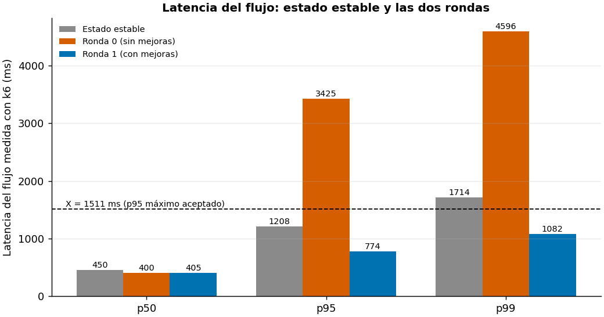

# Tablero del experimento de agotamiento de CPU

Muestra a la vez la ventana de inyección y la métrica objetivo de las dos rondas.


Cada columna es una ronda y el eje va en minutos desde que arrancó el fallo, así que las
rondas se leen una sobre la otra. La franja sombreada son los 180 s de CPU saturada; las
escalas verticales son las mismas en las dos rondas.

| Panel | Qué mide | De dónde sale |
|---|---|---|
| p95 del API por pod | latencia que ve el servidor, en ventanas de 10 s | Cloud Logging (`datos/servidor-ronda*.csv`) |
| Retraso del bucle | cuánto se atrasa el proceso por falta de CPU; la señal de la sonda de readiness | `/metrics` de cada pod (`evidencia/ronda-*/lag-pods.csv`) |
| CPU por pod | consumo frente al límite (250m en la ronda 0, 500m en la ronda 1) | `kubectl top` (`evidencia/ronda-*/cpu-pods.txt`) |

La métrica objetivo del experimento, la latencia p95 del flujo completo medida con k6, está
en `comparacion.png`:



## Tablero vivo en Cloud Monitoring

`cloud-monitoring.json` define el tablero (CPU, uso frente al límite y memoria de cada pod
del API). Se crea con:

```bash
gcloud monitoring dashboards create --config-from-file=caos/tablero/cloud-monitoring.json
```

Para ver una ronda se ajusta el rango de tiempo a su ventana (en UTC): ronda 0, de las
17:54:12 a las 17:57:12 del 14 de noviembre; ronda 1, de las 22:00:14 a las 22:03:14.

## Regenerar las imágenes

```bash
bash caos/tablero/exportar_logs.sh 2026-11-14T17:53:30Z 2026-11-14T17:58:30Z ronda0.csv
python caos/tablero/agregar_logs.py ronda0.csv 0 caos/tablero/datos
python caos/tablero/dibujar.py
```

(lo mismo con `2026-11-14T21:59:30Z 2026-11-14T22:04:30Z` y el número 1 para la ronda 1).
