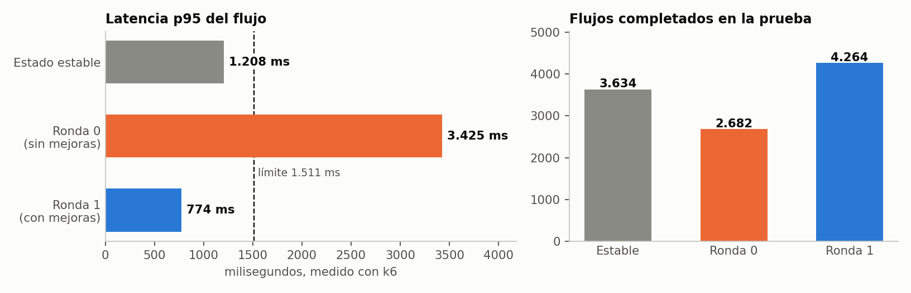
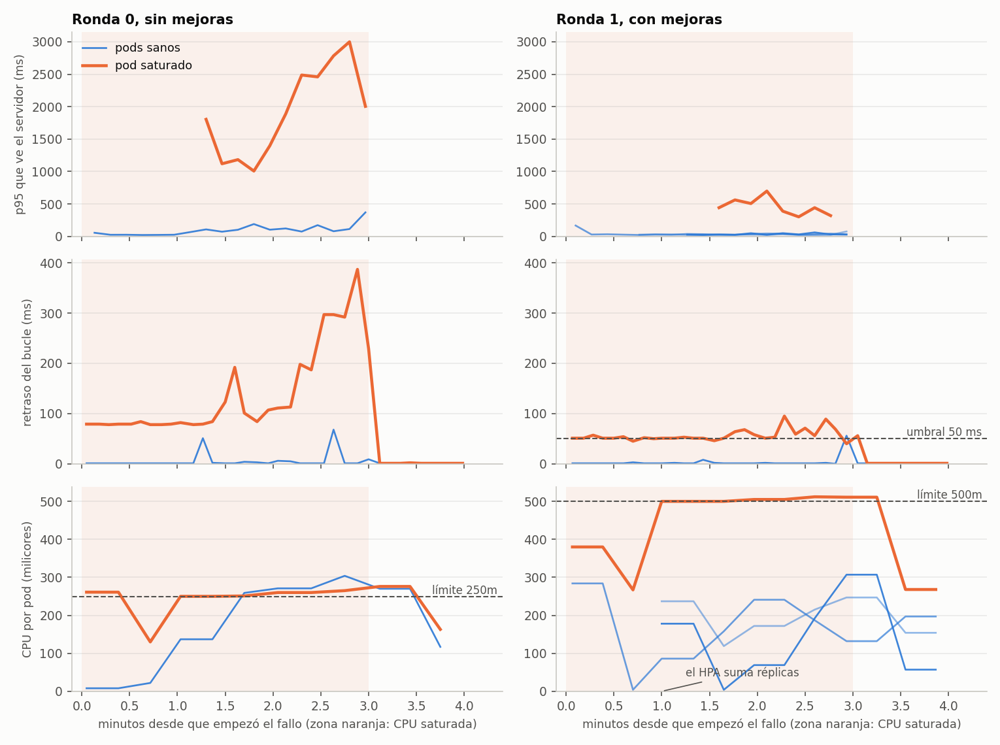
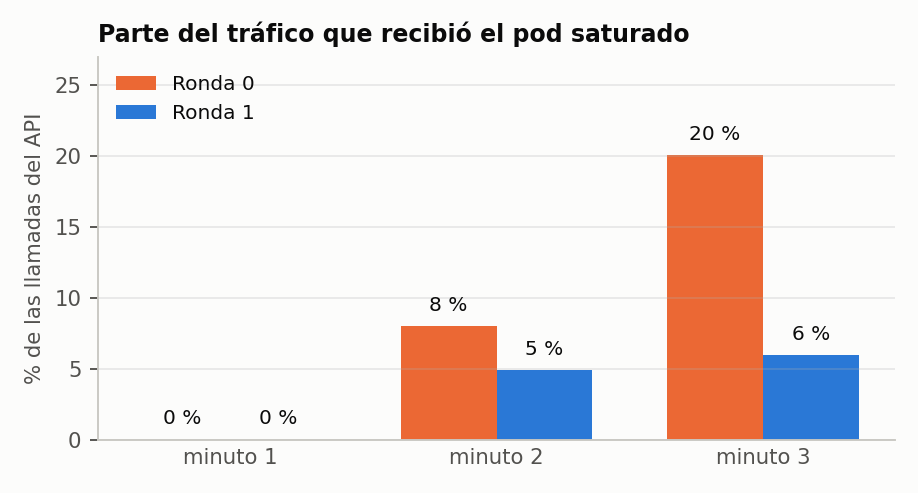

# Tablero del experimento de CPU

Reúne en un solo lugar la ventana de inyección y la métrica objetivo de las dos rondas.



La gráfica de la izquierda es la métrica objetivo (p95 del flujo medido con k6) frente al
límite de 1.511 ms; la de la derecha, cuántos flujos completó cada prueba.



Cada columna es una ronda y el eje va en minutos desde que empezó el fallo, así que se leen
una sobre otra. La zona naranja son los 180 s de CPU saturada. Las escalas verticales son las
mismas en las dos rondas.

| Panel | Qué mide | De dónde sale |
|---|---|---|
| p95 que ve el servidor | latencia del API en ventanas de 10 s, por pod | Cloud Logging (`datos/servidor-ronda*.csv`) |
| Retraso del bucle | cuánto se atrasa el proceso por falta de CPU; es la señal de la readiness | `/metrics` de cada pod (`evidencia/ronda-*/lag-pods.csv`) |
| CPU por pod | consumo frente al límite (250m en la ronda 0, 500m en la 1) | `kubectl top` (`evidencia/ronda-*/cpu-pods.txt`) |



## Tablero vivo en Cloud Monitoring

`cloud-monitoring.json` define un tablero con la CPU, el uso frente al límite y la memoria de
cada pod. Se crea con:

```bash
gcloud monitoring dashboards create --config-from-file=caos/tablero/cloud-monitoring.json
```

Para ver una ronda se ajusta el rango de tiempo a su ventana, en UTC: ronda 0, de las 17:54:12
a las 17:57:12 del 14 de noviembre; ronda 1, de las 22:00:14 a las 22:03:14.

## Cómo se generan las gráficas

Ninguna cifra está escrita a mano: las gráficas y el informe salen de `evidencia/` y de
`datos/`. Para rehacer `datos/` desde Cloud Logging:

```bash
bash caos/tablero/exportar_logs.sh 2026-11-14T17:53:30Z 2026-11-14T17:58:30Z ronda0.csv
bash caos/tablero/exportar_logs.sh 2026-11-14T21:59:30Z 2026-11-14T22:04:30Z ronda1.csv
python caos/tablero/agregar_logs.py ronda0.csv 0 caos/tablero/datos
python caos/tablero/agregar_logs.py ronda1.csv 1 caos/tablero/datos
python caos/tablero/resumen_pods.py ronda0.csv ronda1.csv caos/tablero/datos
python caos/tablero/dibujar.py
```
