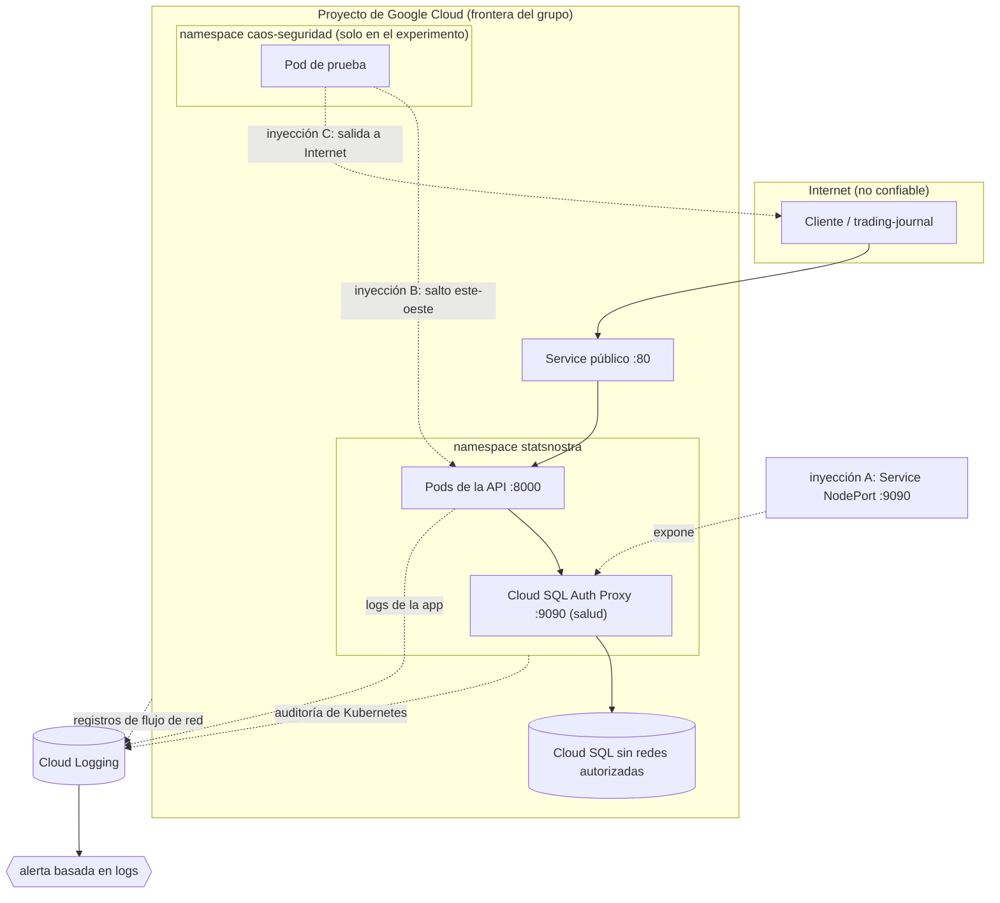

# Caos de seguridad: StatsNostra en GKE

Parte de defensa en profundidad de StatsNostra. El experimento de esta API es el 2, exposición y
segmentación: ¿qué pasa si aparece una ruta no declarada dentro del clúster, y cuánto tardamos en
verla y en cerrarla?

Antes de ejecutar nada hay que tener aceptadas las [reglas de compromiso](reglas-de-compromiso.md).
Cada acción queda en la [bitácora](bitacora.md).

| Documento | Para qué sirve |
|---|---|
| [`reglas-de-compromiso.md`](reglas-de-compromiso.md) | Ventana, alcance, radio de impacto, parada, reversión y aborto |
| [`inventario-controles.md`](inventario-controles.md) | Controles por capa, con lo que hay hoy y los huecos |
| [`deteccion/`](deteccion/) | Reglas de detección como código, con casos positivos y negativos |
| [`bitacora.md`](bitacora.md) | Registro de cada acción durante las ventanas |

## Capas, puntos de inyección y telemetría



Fronteras de confianza: Internet frente al Service público, el namespace `statsnostra` frente a
cualquier otro namespace, y los pods frente a Cloud SQL (solo por el proxy). Puntos de telemetría:
logs JSON de la API con trace id, auditoría de actividad de Kubernetes y registros de flujo de la
subred.

## Experimento 2: exposición y segmentación

**Condición adversa.** Aparece una ruta no declarada: un Service que expone el puerto de
administración (A), un pod de otro namespace que llama a la API (B) o un pod que sale a Internet
sin filtrar (C).

**Hipótesis de control.** Con la red tal como está hoy, cuando se cree un Service que exponga el
puerto de administración, esperamos una alerta en 5 minutos o menos (T1) y su eliminación en 10
minutos o menos (T2).

**Señal.** Registros de auditoría de GKE (actividad de administración) y registros de flujo de la
red, con una alerta basada en logs de Cloud Logging.

**Ronda 0.** Sin alerta ni NetworkPolicy. Lo esperado, según el inventario, es que la hipótesis
se refute: no hay ninguna regla que mire la creación de Services. Se mide MTTD y MTTC reales.

**Mejoras de la ronda 1** (al menos dos):

1. Alerta de Cloud Logging sobre la creación de Services expuestos
   ([`deteccion/`](deteccion/reglas.py)).
2. NetworkPolicy con denegación por defecto de entrada y salida y permisos explícitos para lo que
   el flujo necesita.
3. Filtrado de salida de los pods.

**Mapeo.** ATT&CK: Exploit Public-Facing Application (T1190), Remote Services (T1021) y
Exfiltration Over Alternative Protocol (T1048). D3FEND: Network Isolation (D3-NI), Inbound Traffic
Filtering (D3-ITF), Outbound Traffic Filtering (D3-OTF) y Network Traffic Analysis (D3-NTA). Los
cuatro identificadores de D3FEND y los tres de ATT&CK se comprobaron en d3fend.mitre.org y en
attack.mitre.org el 15 de noviembre de 2026.

## Trazabilidad

| Control | Experimento | D3FEND | ISO/IEC 27001:2022 | NIST SP 800-53 |
|---|---|---|---|---|
| NetworkPolicy de denegación por defecto | 2 (B) | D3-NI, D3-ITF | A.8.22 Segregación de redes | AC-4, SC-7 |
| Filtrado de salida | 2 (C) | D3-OTF | A.8.23 Filtrado web | SC-7 |
| Alerta de Services expuestos | 2 (A) | D3-NTA | A.8.16 Actividades de seguimiento | SI-4, IR-4 |
| Registros de flujo de red | 2 (B, C) | D3-NTA | A.8.15 Registro | AU-2, AU-12 |
| Microsegmentación por namespace | 2 (B) | D3-NI | A.8.22 | NIST SP 800-207, tenet de acceso por recurso |

## Cómo se prueba la detección

```bash
pytest tests/test_deteccion_service_expuesto.py -v    # casos positivos y negativos, sin tocar la nube
python seguridad/deteccion/reglas.py                  # imprime el filtro que se pega en Cloud Logging
```

La regla se escribe una sola vez en `deteccion/reglas.py` y de ahí salen el filtro y la
evaluación de los casos, para que lo que se prueba sea lo que se despliega.
