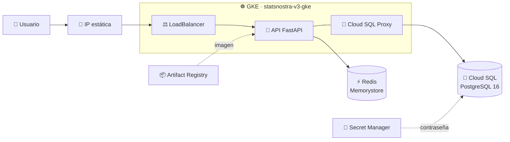

# 🏗️ StatsNostra v3 · Infraestructura como código

Esta carpeta es el corazón de la **v3 de StatsNostra (Entrega 3)**: con un solo
comando de Terraform se levanta en Google Cloud todo lo que necesita el API de
predicciones deportivas, y con otro se borra por completo.

> En la v2 la infraestructura se creó a mano desde la consola de GCP. En la v3
> todo está escrito en código: es repetible, se revisa en Git y se puede destruir
> para no gastar crédito.

## 🗺️ Qué se levanta

## 🧩 Un archivo por servicio

| Archivo | Servicio de GCP | Qué crea |
|---|---|---|
| `gke.tf` | ☸️ Google Kubernetes Engine | Clúster zonal con 2 nodos `e2-medium` |
| `cloudsql.tf` | 🐘 Cloud SQL | PostgreSQL 16, base `statsnostra_v3` y usuario `statsnostra_app` |
| `redis.tf` | ⚡ Memorystore | Redis 7 de 1 GB que hace de caché del API |
| `artifact_registry.tf` | 📦 Artifact Registry | Repositorio Docker para la imagen del API |
| `ip.tf` | 📍 Compute Engine | IP externa estática para entrar al API |
| `secretos.tf` | 🔐 Secret Manager | Contraseña de la base de datos |
| `apis.tf` | 🔧 Service Usage | Activa las APIs de GCP que los demás servicios necesitan |

Y los archivos de apoyo: `versions.tf` (versiones), `providers.tf`,
`backend.tf` (dónde se guarda el estado), `variables.tf`, `outputs.tf` y
`terraform.tfvars.example`.

Todo lleva el prefijo **`statsnostra-v3`** para distinguirlo de lo que se
construyó en la v2.

## ✅ Antes de empezar

- **Terraform 1.11 o superior** → `terraform version`
- **Google Cloud CLI** con sesión iniciada → `gcloud auth application-default login`
- Un **proyecto de GCP** con facturación activa y permisos de propietario
