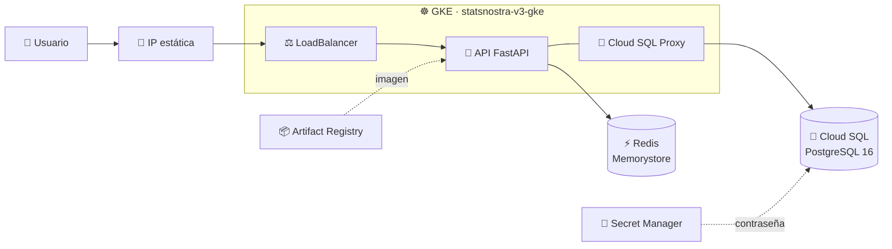

# 🏗️ StatsNostra v3 · Infraestructura como código

Esta carpeta es el corazón de la **v3 de StatsNostra (Entrega 3)**: con un solo
comando de Terraform se levanta en Google Cloud todo lo que necesita el API de
predicciones deportivas, y con otro se borra por completo.

> En la v2 la infraestructura se creó a mano desde la consola de GCP. En la v3
> todo está escrito en código: es repetible, se revisa en Git y se puede destruir
> para no gastar crédito.

## 🗺️ Qué se levanta



## 🧩 Un archivo por servicio

| Archivo | Servicio de GCP | Qué crea |
|---|---|---|
| `gke.tf` | ☸️ Google Kubernetes Engine | Clúster zonal con 2 nodos `e2-medium` |
| `cloudsql.tf` | 🐘 Cloud SQL | PostgreSQL 16, base `statsnostra_v3` y usuario `statsnostra_app` |
| `redis.tf` | ⚡ Memorystore | Redis 7 de 1 GB que hace de caché del API |
| `artifact_registry.tf` | 📦 Artifact Registry | Repositorio Docker para la imagen del API |
| `ip.tf` | 📍 Compute Engine | IP externa estática para entrar al API |
| `secretos.tf` | 🔐 Secret Manager | Contraseña de la base de datos |
| `apis.tf` | 🔧 Service Usage | Activa las APIs de GCP que los demás servicios necesitan |

Y los archivos de apoyo: `versions.tf` (versiones), `providers.tf`,
`backend.tf` (dónde se guarda el estado), `variables.tf`, `outputs.tf` y
`terraform.tfvars.example`.

Todo lleva el prefijo **`statsnostra-v3`** para distinguirlo de lo que se
construyó en la v2.

## ✅ Antes de empezar

- **Terraform 1.11 o superior** → `terraform version`
- **Google Cloud CLI** con sesión iniciada → `gcloud auth application-default login`
- Un **proyecto de GCP** con facturación activa y permisos de propietario

## 🪣 Paso 1 · Bucket para el estado (una sola vez)

Terraform guarda lo que ha creado en un archivo de **estado**. Para que lo usen
tanto tu computador como el pipeline, vive en un bucket de Cloud Storage. Este
bucket se crea a mano y **no** forma parte del `destroy`, así el estado
sobrevive aunque la infraestructura se borre.

```bash
gcloud storage buckets create gs://statsnostra-v3-estado-3f57bb8c \
  --project=project-3f57bb8c-371e-4b9c-949 \
  --location=us-central1 \
  --uniform-bucket-level-access \
  --public-access-prevention

gcloud storage buckets update gs://statsnostra-v3-estado-3f57bb8c --versioning
```

El versionado permite recuperar un estado anterior si algo sale mal.

## 🚀 Paso 2 · Crear la infraestructura

Desde esta carpeta (`terraform/`) son tres comandos:

| | Comando | Qué hace |
|---|---|---|
| 1️⃣ | `terraform init -backend-config="bucket=statsnostra-v3-estado-3f57bb8c"` | 📥 Descarga los providers y conecta con el bucket del estado |
| 2️⃣ | `terraform plan` | 👀 Muestra qué se va a crear, sin tocar nada |
| 3️⃣ | `terraform apply` | 🏗️ Crea todo. Tarda de 10 a 15 minutos, GKE es lo más lento |

> ⚙️ ¿Quieres cambiar la región, el prefijo o el proyecto? Copia
> `terraform.tfvars.example` a `terraform.tfvars` y edítalo. Ese archivo está en
> el `.gitignore`, así que no se sube al repositorio.

### 📤 Lo que devuelve Terraform

Al terminar, `terraform output` entrega los datos que usa el despliegue:

| Output | 🎯 Para qué sirve |
|---|---|
| `ip_api` | 📍 Dirección pública donde queda el API |
| `cluster` | ☸️ Clúster al que se conecta `kubectl` |
| `redis_host` | ⚡ IP privada de Redis (variable `REDIS_HOST`) |
| `cloudsql_conexion` | 🐘 Nombre de conexión del Cloud SQL Proxy |
| `repositorio_imagenes` | 📦 Ruta donde se sube la imagen Docker |
| `secreto_db` | 🔐 Secreto que guarda la contraseña de la base |

> 🔒 **La contraseña de la base nunca aparece** en el código, en el estado ni en
> los logs: Terraform la genera al vuelo y la guarda directo en Secret Manager.
