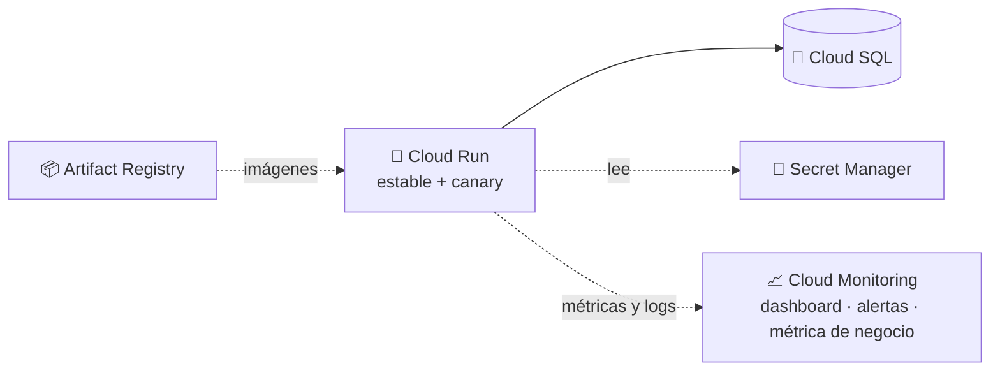

# 🏗️ StatsNostra v4 · Infraestructura como código

Esta carpeta define con Terraform lo que rodea al Canary Deployment de la v4:
la base de datos, el registro de imágenes, los secretos, la cuenta con la que
corre el API y todo el monitoreo (dashboard, alertas y métrica de negocio). Las
dos revisiones de Cloud Run (estable y canary) las despliegan los workflows
`canary-v4-*`, porque cambian en cada versión y su tráfico se reparte por etapas.

> La v3 de esta carpeta creaba un clúster de GKE, Redis y una IP fija. En la v4
> el API corre en Cloud Run y esas piezas se retiraron; la v3 completa sigue en
> el tag [`v3.0.0`](https://github.com/MarianaPineda0/StatsNostra/tree/v3.0.0/terraform).

## 🗺️ Qué se levanta



## 🧩 Un archivo por tema

| Archivo | Qué define |
|---|---|
| `versions.tf`, `providers.tf`, `variables.tf` | Versiones (Terraform 1.11+), provider de Google y variables (`nombre` vale `statsnostra-v4`) |
| `backend.tf` | Estado remoto en un bucket de Cloud Storage; el nombre se pasa al hacer `init` |
| `apis.tf` | Activa las APIs de Cloud Run, Cloud SQL, Artifact Registry, Secret Manager, Monitoring y Logging |
| `cloudsql.tf` | Instancia de PostgreSQL 16 (con sufijo aleatorio en el nombre), base `statsnostra_v4` y usuario `statsnostra_app` |
| `artifact_registry.tf` | Repositorio Docker `statsnostra-v4-repo` |
| `secretos.tf` | Contraseña efímera, secreto con la contraseña y secreto con la `DATABASE_URL` de Cloud Run |
| `cuentas.tf` | Cuenta de servicio del API en Cloud Run, solo con permiso para Cloud SQL |
| `monitoreo.tf` | Métrica de negocio basada en logs: predicciones evaluadas por resultado |
| `dashboard.tf` | Dashboard con estable y canary lado a lado: tráfico, errores, latencia p50/p95/p99, CPU, memoria y negocio |
| `alertas.tf` | Alertas de errores 5xx y de latencia p95 del canary |
| `outputs.tf` | Salidas con la conexión de Cloud SQL, el repositorio, los secretos y la cuenta del API |

La contraseña de la base nunca queda en el código ni en el estado: se genera
como recurso efímero y se entrega con atributos de solo escritura.

## ✅ Antes de empezar

- **Terraform 1.11 o superior** → `terraform version`
- **Google Cloud CLI** con sesión iniciada → `gcloud auth application-default login`
- Un **proyecto de GCP** con facturación activa y permisos de propietario

## 🪣 Paso 1 · Bucket del estado y APIs previas (una sola vez)

El estado de Terraform vive en un bucket de Cloud Storage, para que lo usen tu
computador y cualquier pipeline. Se crea a mano y no se borra con el `destroy`.

```bash
gcloud storage buckets create gs://statsnostra-v4-estado-3f57bb8c --project=project-3f57bb8c-371e-4b9c-949 --location=us-central1 --uniform-bucket-level-access --public-access-prevention
```

```bash
gcloud storage buckets update gs://statsnostra-v4-estado-3f57bb8c --versioning
```

Terraform administra las demás APIs, pero necesita dos activas desde antes. Si
faltan, el `plan` falla con un error 403 de *Cloud Resource Manager*:

```bash
gcloud services enable cloudresourcemanager.googleapis.com serviceusage.googleapis.com iam.googleapis.com --project=project-3f57bb8c-371e-4b9c-949
```

## 🚀 Paso 2 · Crear la infraestructura

Desde esta carpeta (`terraform/`):

| | Comando | Qué hace |
|---|---|---|
| 1️⃣ | `terraform init -backend-config="bucket=statsnostra-v4-estado-3f57bb8c"` | Descarga los providers y conecta con el estado |
| 2️⃣ | `terraform plan` | Muestra qué se va a crear, sin tocar nada |
| 3️⃣ | `terraform apply` | Crea todo; Cloud SQL tarda unos 6 minutos |

Si quieres cambiar el proyecto, la región o el prefijo, copia
`terraform.tfvars.example` a `terraform.tfvars`. Ese archivo está en el
`.gitignore`.

## 🐤 Paso 3 · Desplegar el canary

La infraestructura queda lista pero sin API. Las revisiones se despliegan desde
GitHub Actions (*Actions → Run workflow*): primero **`Canary v4 · Desplegar al 0 %`**
y luego **`Canary v4 · Promover por etapas`**. El flujo completo, los umbrales y
la compatibilidad de datos están explicados en la sección
[*Canary Deployment (v4)*](../README.md#-canary-deployment-v4) del README principal.

## 🧹 Paso 4 · Destruir

Al terminar, para no gastar crédito (Cloud SQL es el único servicio sin capa
gratuita):

```bash
terraform destroy
```

Antes conviene borrar el servicio de Cloud Run y el trabajo de migración, que no
están en Terraform:

```bash
gcloud run services delete statsnostra-api --region=us-central1 --project=project-3f57bb8c-371e-4b9c-949 --quiet
```

```bash
gcloud run jobs delete statsnostra-migrar --region=us-central1 --project=project-3f57bb8c-371e-4b9c-949 --quiet
```

El bucket del estado no se borra con el `destroy`. Para comprobar que no queda
nada que cobre:

```bash
gcloud sql instances list
gcloud run services list --region=us-central1
gcloud artifacts repositories list --location=us-central1
gcloud secrets list
```
